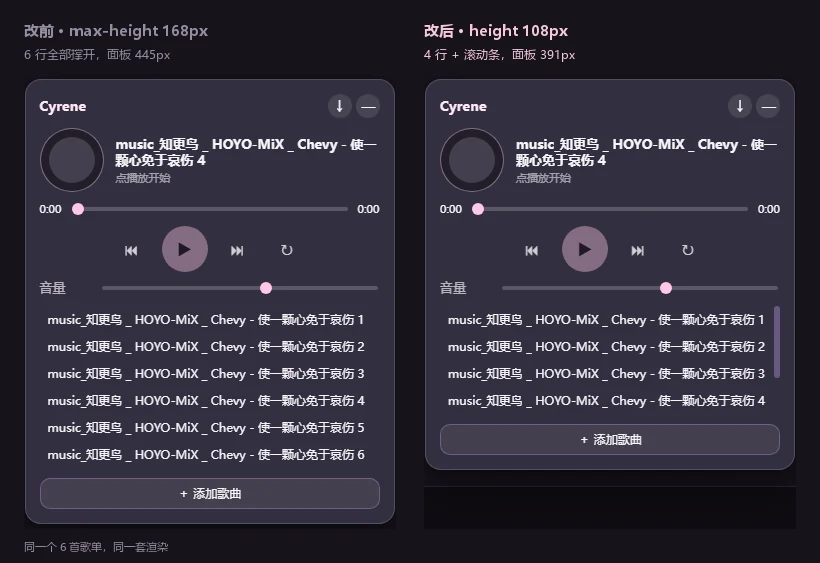

# dsh-theme-cyrene · 昔涟主题

DeepSeek Harness 客户端主题插件：淡粉柔光配色 × 半透明壁纸 × 环境流萤粒子 ×
背景音乐 × 打字音效 × 可拖动控制面板。

功能对齐社区同类主题插件，但在几处做了不同的工程选择（见下方「与参考实现的差异」）。

## 预览图


---

## 快速开始

```powershell
# 1. 安装进 desktop profile（本机 DSH 桌面版）
$env:ELECTRON_RUN_AS_NODE="1"
& "<DSH 安装目录>\DeepSeek Harness.exe" `
  "<DSH 安装目录>/resources/app.asar\dsh\node_modules\@deepseek-ai\dsh-desktop-host\lib\cli.js" `
  plugin --profile desktop add "link:<本仓库>\dsh-theme-cyrene"

# 2. 重启 DeepSeek Harness
```

装完左下角会出现一个毛玻璃长条，四个按钮（自左向右）：

| 按钮 | 功能 |
|---|---|
| **Sound** | 打字音效 开 / 关（Web Audio 实时合成，零音频文件） |
| **Particles** | 氛围粒子分档：关 → 星点(12) → 曳光(28) → 流萤(80) |
| **Scene** | 壁纸设置：类型（动态/静态）、**亮度 / 遮罩滑块**、**玻璃质感开关**、随机轮换与间隔、选择壁纸、添加壁纸 |
| **Cyrene** | 背景音乐：播放 / 上一首 / 下一首 / 三种循环模式 / 音量 / 歌单 / 迷你播放器。点它 → 面板从控制条这里**展开**（180ms，`transform-origin` 锚在左下角），表头同样写着 **Cyrene** |
| **‹** | 手动收起（最后一个按钮） |

**整条控制条走英文。** 原来四个汉字（声 / 萤 / 景 / 乐）命名的是**媒介**，但这条控制条管的是
**主题**——其中还有一个是角色本人。`Cyrene` 一个汉字说不清，索性统一：
`font-size: 12px` + `letter-spacing: 0.03em`，四个多字符标签才不会各自读成主操作按钮。

> 表头也写 `Cyrene` 而不是「背景音乐」：点它打开、打开后还是同一个名字，面板读起来才像
> 「她展开了」，而不是一张碰巧关于音乐的设置表。

**收起时是她的头像，不是「昔」字。** 42px 圆形头像 + 粉色描边环——**在这个尺寸上，
一张脸比一个字更容易认出来**，而且控制条折起来之后她仍然在场。
`brand/` 没有头像时退回一个纯色圆点，不会出现空按钮。

```powershell
python tools/crop-avatar.py            # 候选裁剪对比图 docs/avatar-candidates.png
python tools/crop-avatar.py --write    # 写入 brand/cyrene-avatar.webp + 尺寸预览
```

裁剪框是 `tools/crop-avatar.py` 里的 `CHOSEN`；`--write` 会另外输出 `docs/avatar-preview.png`，
把圆形裁剪按 **96 / 64 / 42 / 32 px** 各画一遍——**42px 是圆点的真实尺寸，脸在那个尺寸糊不糊，
只能看不能算。**

> **头像为什么不在 `assets/` 里。** `assets/` 下的一切都会被扫进 Scene 的壁纸网格，
> 她的头像不该出现在那里。所以单开了 `brand/` bucket（宿主 `PKG_BUCKETS` 已加）。
> 测试同时断言「`brand/` 能取到」和「不在壁纸清单里」两件事。

> ⚠️ **这一版要重启 DSH，光刷新不够。** 这一轮动了 `lib/index.js`（bucket 白名单），
> 而 host 半边是 **DSH 启动时加载**的——不重启的话 `brand/` 会 404，圆点会退回纯色圆。

**位置与收起。** 控制条默认停在**左下角**，可按住任意空白处拖动（位置自动记忆）。
`4.2 秒`没有交互就自动收起成那个头像圆点，点一下再展开；
有浮层打开时不会收起——把浮层底下的锚点抽走比碍眼更糟。想立刻收起就点最右边的 **‹**。

`ESC` 关闭浮层；音乐面板展开时 `ESC` 收起为迷你播放器。

素材放法与目录约定见 **[ASSETS.md](./ASSETS.md)**。

---

## 表情包（emote 彩蛋）

聊天里出现特定词时，右下角会弹出一张小昔涟：

| 文件名 | 触发的词 | 画面 |
|---|---|---|
| `开心.webp` | 谢谢 / 太好了 / 太棒 / 厉害 / 绝了 / 感谢 / 辛苦 | 闭眼吐舌大笑 |
| `得意.webp` | 搞定 / 完成 / 成功了 / 已解决 / 通过了 | 托腮得意 |
| `没错.webp` | 没错 / 正是 / 确实 / 对的 / 就是这样 | 自信眨眼 |
| `期待.webp` | 发我 / 提供 / 给我 / 发一下 / 贴一下 | 星星眼期待 |
| `疑惑.webp` | 确认一下 / 要我 / 可以吗 / 是否 / 确定吗 | 抱臂怀疑 |

> ⚠️ **文件名就是接线。** 客户端不查任何注册表——它拿触发的词去比对**条目的 label**，
> 而 label 就是**去掉扩展名的文件名**（`build.mjs` 的 `labelOf`）。
> 把 `开心.webp` 改名，说「谢谢」就再也不会弹东西，而且**不报错**：没有异常、
> 没有控制台警告、没有失败请求，彩蛋只是不再触发。
> 所以有一条测试专门盯这个——两个方向都查：每个文件都要有规则，每条规则都要有文件。

### 两处是「看图改出来的」

第一版我把标签硬套到素材上，渲染出对照图一看就露馅了：

- `没错` 分到了一张**赌气脸**（压着眉毛、抱臂）
- `期待` 分到了眨眼

两处正好**反了**。官方表情的文件名只有编号，编号没有任何含义，**只能靠看**。
重新对照后改成：`疑惑` ← 抱臂怀疑脸，`没错` ← 自信眨眼。

`变身` 更明显：第一版用了一张 Eidolon 图，渲染出来是**一块紫色水晶**（她在水晶体里），
在 148px 下只会读成一团抽象色块。改用立绘，并**按 alpha 包围盒自动裁出上半身**
（不写死坐标，换素材也不会失效）。

> **后来删掉了。** 这一节记的是当初做那张动画时量到的数据，留作参考——
> 动画表情已按你的要求移除，现在是一套 5 张静图。
> 生成器里的 `ANIMATED` 留成了空字典，想加回来是一行的事。

### 为什么动画是 WebP 不是 GIF

第一版按「GIF 文件」的字面要求输出了 GIF：

| | 体积 |
|---|---|
| `变身.gif` | **460 KB** |
| `变身.webp`（同样 22 帧） | 261 KB |

GIF **不能带半透明**，只能整帧不透明，所以边缘被强行压到背景色上。而 `ANIM_EXT`
本来就接受 `.webp`，覆盖层也只是个 ``——浏览器自己会播。
最终 16 帧 / 82 质量 / **271 KB**。

### 重新生成

```powershell
npm run emotes      # 从 brand/pet/ 重新生成 5 个文件 + 对照图
```

对照图在 `docs/emote-set.png`——**改映射之前先看它**。

---

## 小昔涟（宠物）

右下角站着一个小昔涟。**她的表情就是官方聊天表情包**——这是采集的时候才发现的：

| 文件 | 表情 |
|---|---|
| `sticker-ppg-24-cyrene-01` | 开心（默认待机） |
| `sticker-ppg-24-cyrene-02` | 惊讶 |
| `sticker-ppg-24-cyrene-03` | 得意 |
| `sticker-ppg-24-cyrene-04` | 眨眼 |
| `sticker-ppg-24-cyrene-05` | 闪亮 |

Q 版、透明底、五种不同情绪——**正好就是宠物需要的东西**，不用我从立绘上抠。

### 她会做什么

| 时机 | 反应 |
|---|---|
| 一直待机 | 呼吸起伏 + 缓慢浮动。**两个周期不同的动画叠加**，所以看不出循环 |
| 不定时 | 眨眼。间隔在 5.2 秒上下随机抖动，**不落在能被预判的节拍上** |
| 打字 | 每 9 秒最多一次，随机会「闪亮」或「惊讶」 |
| 发送（回车） | 开心 |
| 鼠标移上去 | 惊讶 |
| 点她 | 闪亮 + 弹一下 |
| **75 秒没人理** | 得意地看你一眼，**每个静默周期只提醒一次** |

**每个反应都是单次的，会自己回到待机。** 停在某个表情上不是「有情绪」，是 bug。

可以拖动换位置（位置记忆）。点她**不会穿透到底下的界面**——否则点她会顺手关掉一个浮层。

开关：**景 → 陪伴 → 小昔涟 · 开/关**。

### 素材是怎么来的

```powershell
python tools/harvest-assets.py            # 只列出会抓什么
python tools/harvest-assets.py --write    # 抓进 brand/pet/ 并出素材总览图
```

工具里记着三个坑，都是踩过的：

1. **页面上的图大部分不是她的。** `Cyrene/Media` 会展开一个导航模板，`prop=images` 返回 99 个
   `Character *`，绝大多数是别的角色。所以过滤用的是**显式白名单**，不是包含匹配。
2. **CDN 防盗链。** `static.wikia.nocookie.net` 不带 `Referer` 一律 403。
3. **搜索会漏。** `srsearch=intitle:Sticker Cyrene` 返回 **0 命中**，因为真实标题是
   `Sticker PPG 24 Cyrene 01.png`——中间隔着套号。**官方表情包是靠拉全量清单才发现的，
   搜索永远找不到。**

> **表情的语义是「看」出来的。** 文件名里的 `01..05` 没有任何含义，哪张是哪个表情只存在于
> `build.mjs` 的 `PET_ROLES` 里。重新上传一套改了编号的表情会**静默打乱她的情绪**，
> 所以这个映射是唯一的真相来源，代码里也标了。

> **宠物在素材清单落地之后才挂载。** 一开始我用构建期清单直接创建她——打包的素材看起来完全
> 正常，但那是错的：**最后一次构建之后新增的表情只存在于宿主清单里，她会一声不响地忽略它。**
> 现在宿主清单失败也会挂载，只是用构建期那份。

---

## 歌单是一个窗口，不是一张列表

播放器里的歌单**固定显示 4 行**，再多就滚动。



起因是**面板会随曲库一起长高**。歌单一长，面板就从左下角往上顶，最后把「Cyrene」那个
按钮推出屏幕外——而那是回到面板的唯一入口，等于把自己关在外面。

| | 改前 | 改后 |
|---|---|---|
| 规则 | `max-height: 168px` | `height: 108px` |
| 看得见 | 6 行（168 / 27 ≈ 6.2） | 4 行 |
| 6 首歌时面板 | 445px | **391px** |
| 60 首歌时面板 | 还是 445px | **还是 391px** |

60 首那行是重点：**面板高度不再和曲库大小有关**。

### 三个数字是量出来的，不是估的

`tools/probe-panel.mjs` 把浏览器半体按 `build.mjs` 的方式重新拼一遍，挂进真 Chromium，
读回引擎算出来的值。行高 **27px**（12px 字号 → 18px 行盒，+6px 上下内边距），
所以 4 × 27 = **108px**。

用 `calc(4 * var(--cy-song-h))` 看着更讲究，**实测会差 2px**：分数行高被引擎取整，
一来一回就多露出第五行的一条边。写死 108 在每个缩放级别都准。

### 两个踩过的坑，都写进注释了

**① CSS 变量的声明必须自带选择器块。** `CONTROL_CSS` 数组里**每一项都是一条完整的规则**，
所以 `"  --cy-playlist-h: 108px;"` 会被解析器**静默丢弃**——它是一条没有选择器的声明。
正确写法是 `":root { --cy-playlist-h: 108px; ... }"`。我第一次就是写错的，
面板在真浏览器里量出来还是老样子。

**② `scrollbar-width: thin` 比 `::-webkit-scrollbar` 更宽。** 实测：

| 写法 | 滚动条宽度 |
|---|---|
| `scrollbar-width: thin` + `::-webkit-scrollbar{width:6px}` | **10px** |
| 只写 `::-webkit-scrollbar{width:6px}` | **6px** |
| 只写 `scrollbar-width: thin` | 10px |
| 什么都不写 | 15px |

也就是说「更现代的写法」不但没生效，**还把宽度顶掉了**。所以这里刻意不写标准属性，
和壁纸网格保持一致——测试里有一条断言专门防止有人「顺手补上」。

### 打开面板时会滚到正在播的那首

歌单是四行窗口，所以正在播的那首常常在折叠线以下。挂载之后会把它滚进视野
（`block: "nearest"`，滚动最小距离）。

只在**曲目真的变了**的时候滚：`sync()` 挂在每次播放事件上，拖动进度条一秒钟能触发几十次，
每次都滚会把用户正在翻的列表**抢回去**。所以它比对的是上一次标记的那一行，
不是无条件执行。

---

## 开场动画（已停用）

> **内置的开场动画已经移除**——你决定不做开场动画了，`GIF/cyrene-boot.webp` 已删除，
> 构建时报 `no boot GIF — the opening animation stays off` 是预期行为。
> 整套机制与 `tools/render-boot.py` **都保留**：想恢复就跑一次 `npm run boot`，
> 或者从「景」面板上传一个自己的开场素材。下面记的是它当初是怎么做出来的。

DSH 启动后，**不是一整页画面**——只有两行字浮在压暗的应用之上，字退场，铁道 logo 落下，
然后暗底升起，**窗口就打开了**：

> 翻开这本书吧，
> 我会在过去等你。

- **资产**：`GIF/cyrene-boot.webp` —— 1200×675、**透明**、**60 fps**、4.28 秒、
  渲染 252 帧 → **存储 75 帧**、**3.6 MB**
- **放映方式**：`reveal`（默认）—— 平铺暗底 + 悬浮元素，**没有画面页**
- **结束**：暗底在 800ms 内升起，同时 logo 微微放大淡出 → **露出下面的窗口**；
  点任意处立即跳过

> ⚠️ **重渲染得更长就要同步改 `BOOT_FALLBACK_MS`**，否则动画会在中途被切掉。
> 现在是 4.2 秒 + 0.8 秒开窗 = 5.2 秒。

**每个浏览器会话只放一次**（`sessionStorage` 标记），所以**刷新页面不会再放**。
想再看一遍，在对话里发 **`昔涟`**、`CYRENE` 或 `SAM` 即可重放。

### 为什么是透明的，以及这顺手删掉了什么

第一版把动画**合成在整屏星空上**——那是一片画面页。要合成到星空上，就得先把烧进图里的
两行字弄掉：垂直插值、匹配胶片颗粒、边缘羽化，一整套。

**改成透明之后，那套东西整个不需要了。** 没有星空要合成，就没有「干净底片」这件事——
原图现在只被用来**量**文字的位置和大小，字直接画在透明画布上。
一个设计决定删掉了一整类问题。

### 四拍时间轴

时间轴用**秒**定义（`tools/render-boot.py` 的 `BEAT`），而不是比例，方便直接推算：

| 拍 | 时间 | 内容 |
|---|---|---|
| line1 | 0.30 – 1.05 | 「翻开这本书吧，」升起 |
| line2 | 0.85 – 1.60 | 「我会在过去等你。」升起 |
| lines_out | 2.00 – 2.50 | **两行字退场** |
| logo_in | 2.62 – 3.42 | 铁道 logo 淡入并上浮 |
| （放映层） | 之后 0.8s | 暗底升起、logo 放大淡出 → **开窗** |

**为什么字要先退场**：它和 logo 占同一条中间带。第一版让两者交叉淡化，结果是
「翻开这本书吧」**压在 logo 左边缘上**。现在每一拍独占画面——`lines_out` 在 2.90 结束，
`logo_in` 从 3.00 才开始。

### 它是怎么做出来的

两张图都来自你的 PV 截图，各自的障碍不同：

**星空那张**四边有黑边、字已经**烧进画面**。烧进去的字没法做动画，所以先抹掉再逐帧重绘。
这一步之所以安全，**是因为字所在的位置**：那两行压在一片**平滑的垂直渐变天色**上，
附近没有星星细节。所以：

1. **垂直插值**（不是水平）—— 天色是垂直渐变，紧邻的上下两行已经把它描述清楚了；
2. **匹配颗粒** —— 原作有胶片感噪点，补出来的区域如果过于平滑，即使颜色对了也会
   **在画面正中显出一块矩形**。第一版就是这么露馅的；
3. **边缘羽化** —— 去掉接缝。

**logo 那张**背景是**纯色**（四角标准差 0.6–1.0），所以直接抠：
按「到背景色的距离」做软边蒙版。阈值不是猜的——量出来**背景残影最高到 14，
她的淡色线稿从 29 起**，`18` 落在中间那段空档里。另外右下角那个视频水印被单独遮掉了。

> 抠图本身踩过一个坑：阈值定得太松时，画面上会出现**一块矩形灰斑**——原图那里有一片
> 极淡的色差（只有 7 个色阶），落进中间阈值带就被抬成了可见的半透明。
> 校准过的阈值 + 一个 `0.25` 的地板把它压掉了。对照图见 `docs/boot-logo-alpha.png`。

### 流畅度是算出来的，不是感觉出来的

第一版是 **15 fps**（36 帧 / 2.4 秒），淡入确实是一格一格的。现在 60 fps。

调优时量过几个数：

| | 结果 |
|---|---|
| 去掉 logo 的**缩放**动画 | 4048 → 3615 KB（缩放每帧重采样，产生全新栅格） |
| 相同帧合并 | 264 帧 → **100 帧存储**（尾部静止停留不再逐帧付钱） |
| 质量 86 → 72 | 2612 → 1619 KB，**但画面上几乎看不出差别** |

**最终选了质量 86**：素材从 localhost 本地服务，体积几乎不要钱，而**观感是要钱的**。
质量对照图在 `docs/boot-quality.png`（线稿细节 / 天空渐变，两档并排）。


> 如果换一张**文字压在星星或主体上**的图，这套做法会糊掉细节，需要换思路（比如把文字层
> 单独要一份，或者改成整幅淡入而不重绘文字）。

### 一个顺手修掉的 bug

原来的代码写着「GIF 自己决定长度；静图靠定时器」，**于是 GIF 那条路根本没有定时器**——
上传一个循环 GIF 当开场，它会**永远盖住整个窗口，只能点掉**。现在两种都挂定时器，
GIF 给更长的预算（4.6 秒）而不是不给。已有测试挡住这个回归。

---

## 调外观

整个观感收在 `lib/client/10-constants.js` 的 **`THEME`** 一个对象里，令牌全部由它推导：

| 想改什么 | 改哪里 |
|---|---|
| **紫味有多重** | **`THEME.tint`** —— 唯一的「整体色调」旋钮，见下 |
| 玻璃质感开关 | 「景」面板的 **质感**，或 `DEFAULT_SETTINGS.glass` |
| 中性灰的底色 | `THEME.neutral`（Apple 深色灰阶） |
| 混进去的色相 | `THEME.hue` |
| 主色 / 强调色 | `THEME.pink`、`THEME.pinkStrong`、`THEME.purple` |
| 面板不透明度 | `THEME.alpha`（`base` 是露壁纸的底层；`panel` / `bubble` / `input` / `card` 是堆叠层） |
| 描边轻重 | `THEME.border` |
| 阴影与高光 | `THEME.shadow`、`THEME.specular` |
| 圆角与毛玻璃 | `THEME.radius`、`THEME.blur` |
| 壁纸亮度 | `THEME.wallBrightness`（也可在「景」面板里实时拖） |
| 遮罩浓度 | `THEME.shade`（同上） |

改完跑 `node build.mjs`，刷新页面即可。

### 玻璃质感（Liquid Glass 层）

「景」面板里有一个 **质感** 开关（默认开）。它叠在材质系统之上，做三件事：

| 做了什么 | 为什么 |
|---|---|
| **噪点**（`feTurbulence`，3% overlay） | 大面积模糊渐变在 8 位屏上会有可见色阶，而**色阶正是「糊」的来源**。极少量噪声把色阶抖掉。这是唯一一件功能性而非装饰性的「颗粒」。 |
| **镜面边缘**（145° 渐变描边） | 左上亮、右下暗。**边缘之所以读起来像玻璃，是因为它怎么接光，而不是因为它透明。** 这是整套里最吃重的一招。 |
| **更强的饱和磨砂**（`blur(40px) saturate(200%)`） | 让玻璃明显从背后吸色。 |

> ⚠️ **苹果的真折射做不到，我不假装做到了。** Liquid Glass 会把边缘背后的内容**扭曲**（实时 shader）。
> `backdrop-filter` 只能采样背景、**不能位移**，所以 CSS 复现不了。上面三条是能承载这个观感的部分。

镜面边缘只加在**本插件自己的**浮层上（`.cy-dock` / `.cy-pop` / `.cy-card` / `.cy-dot`）——
宿主的对话框和菜单只能通过 `--dsw-*` token 改，伪元素插不进不属于本插件的 DOM。

关掉它：**景 → 质感 → 玻璃质感 · 关**。开关只改一个 `data-cyrene-glass` 属性，
两张样式表始终挂载，所以是重绘而不是重新挂载，不会把 DOM 拆到一半。

### 苹果式材质：一条旋钮，四条规则

这版按 Apple 的材质系统重做过。它的核心不是装饰，而是**克制**：

| 规则 | 具体做法 |
|---|---|
| **chrome 近中性** | 表面由 `THEME.neutral`（Apple 深色灰阶）**混入** `THEME.hue` 得到，混入比例就是 `THEME.tint`。`0` = 纯灰，`1` = 完全染色。 |
| **边缘是白色发丝线 + 顶部高光** | 不是彩色描边。那点内高光才是让一个面读起来像「材质」而不是「矩形」的东西。 |
| **阴影又宽又软、近黑** | 带紫的阴影看起来是发光，不是纵深。 |
| **模糊更强且提高饱和** | `blur(40px) saturate(180%)` —— 这是把「通透」和「糊」区分开的那一步。 |

**为什么之前看着「糊成一片粉」**：旧配色把每个表面都染了约 40% 的紫（`#3a2c52`，色度扩散 24），
于是粉色强调色**没有中性底子可以对比**，整块 UI 成了一个大色块。现在扩散是 15。

> **圆角别动。** `--dsw-corner-shape` 官方值本来就是 `superellipse(1.5)`——苹果的连续圆角。
> 旧版本把它覆盖成 `round`，白丢了整张样式表里最「苹果」的一样东西。测试会挡住这个回归。

### 改色调是安全的

`tools/check-contrast.mjs` 会把文字在**半透明面板上、再叠在偏亮壁纸上**（最坏情况）算 WCAG 对比度：

```powershell
node tools/check-contrast.mjs          # 报告
node --test test/palette.test.mjs      # 同一套断言，进 CI
```

所以 `tint` 可以放心调——**测试会挡住任何让字读不清的取值**，包括色度扩散上限、发丝线必须中性、
阴影必须近黑、以及圆角覆盖回归。

```powershell
python tools/render-palette-preview.py docs/palette-before-after.png   # 改前改后对照图
```

> **为什么不透明度分两档。** `base` / `layer1` 保持半透明，壁纸才是主角；
> `panel` / `bubble` / `input` / `card` 做到 0.80～0.94 —— 这些是会叠在另一个
> 对话框上面的层，半透明会让背后的文字透出来形成重影，比损失一点通透感糟糕得多。
> 磨砂观感由 `backdrop-filter` 保留，不靠透明度。

> **字体没动。** 官方 token 的字体栈已经是 `-apple-system` 优先、含 Windows 中文回退
> （Microsoft YaHei），正文 16/24 也是苹果校准过的值。主题不该去改这些。

---

## ⚠️ 什么要重启，什么不用

**插件源码是 DSH 启动时读的**（本仓库的 `setup/install.ps1` 与 `docs` 都按这条口径写），
所以动了 `lib/` 下的任何东西（包括 `build.mjs` 刚重新生成的 `lib/client.js`），
**光刷新页面不够，要重启一次 DSH**。

| 改了什么 | 生效方式 |
|---|---|
| **`lib/`**（`index.js`、`client.js`、`client/*.js` 构建产物） | **重启 DSH** |
| **`dsh.client` 声明 / `package.json`** | **重启 DSH** |
| **素材**（往 `assets/` `music/` `GIF/` `brand/` 里放文件、删文件） | **刷新页面**即可 —— 宿主半每次请求清单时实时扫描目录 |
| **面板里的设置**（开关、拖动、上传的壁纸） | 立即，并持久化到 `$DSH_HOME/theme-cyrene/state.json` |
| **改完 `lib/client/*.js`** | 先 `node build.mjs` 重新拼出 `lib/client.js`，**再重启** |

> 这一条踩过一次：`brand/` 那次只动了 `lib/index.js`（bucket 白名单），
> 不重启的话 `brand/` 会 404、头像退回纯色圆点 —— **看起来像「素材没放对」，其实是没重启**。

装完重启之后想确认一下，跑 `node tools/check-live.mjs`（用法与它到底查得了什么、
查不了什么，见下面 **`npm run check-live`** 那一节）。

---

## 卸载

```powershell
$env:ELECTRON_RUN_AS_NODE="1"
& "<DSH 安装目录>\DeepSeek Harness.exe" `
  "<DSH 安装目录>/resources/app.asar\dsh\node_modules\@deepseek-ai\dsh-desktop-host\lib\cli.js" `
  plugin --profile desktop remove dsh-theme-cyrene
```

用户上传的素材留在 `$DSH_HOME/theme-cyrene/`，需要的话手动删除该目录。

---

## `npm run check-live` —— 检查**部署**，不是检查代码

仓库里其它测试验的都是代码。这一条验的是**跑起来的那一份**：通过不需要 token 的插件路由跟
运行中的 GUI 说话、读磁盘上的 profile 补丁，并**明确报告哪些是它查不了的**，而不是暗示都过了。

```powershell
node tools/check-live.mjs
$boot = (Get-Process -Name "DeepSeek Harness").StartTime   # 可选：判断进程有没有读到最新补丁
$env:DSH_BOOT_MS = "$([int64](([datetimeoffset]$boot).ToUnixTimeMilliseconds()))"
```

它不写任何东西。

### 它立刻抓到一个上线了的 bug

第一次运行就报了六个 404：

```
FAIL  开心 fetches  — HTTP 404
FAIL  变身 fetches  — HTTP 404
...
```

**表情包在运行中的界面里根本取不到图。** 根因在 `entry()`：

```js
url: `${PREFIX}/pkg/${spec.bucket}/${name}`      // ✗ 把 bucket 名当成了 URL 路径
```

表情的 bucket 是 `emotes`（那是**上传目录**，也是客户端用来分类的键），而随包的那批实际躺在
`GIF/emotes/`。于是清单发出去的是 `pkg/emotes/…`——路由不服务这个路径。

对照一下就看得出来它是唯一的例外：

| 类型 | 清单给的路径 | 磁盘上的位置 |
|---|---|---|
| 壁纸 | `pkg/assets/…` | `assets/` ✓ |
| 音乐 | `pkg/music/…` | `music/` ✓ |
| **表情** | `pkg/emotes/…` | **`GIF/emotes/`** ✗ |

`covers` 有**一模一样的潜伏 bug**（bucket `covers`，实际在 `music/figure`），只是目录当时是空的。

### 为什么 100 多项测试没抓到

**因为客户端测试的桩里硬编码了它期望的 URL**：

```js
url: `/theme-cyrene-assets/pkg/GIF/${name}`      // 测试自己写的，不是宿主产出的
```

一个和自己保持一致的 fixture 什么都证明不了。**契约的两端必须见面。**
所以新增的 `test/manifest-contract.test.mjs` 走的是**宿主真正产出的清单**，
再把每个 URL 反解回磁盘路径、断言文件存在：

| 断言 | 防的是什么 |
|---|---|
| 每个内置 URL 都能在磁盘上找到对应文件 | 就是本轮这个 bug |
| 每个上传 URL 同样能找到 | 用户目录那一半 |
| `id` 带 bucket、`url` 带路径 | 两者被合并回一个名字（正是 bug 的成因） |
| `safeRelPath` 接受清单广告的形状 | 路由拒绝清单承诺的路径——同一类错配，下一层 |

> 为了让这条测试写得出来，`buildManifest()` 从私有改成了导出。**契约不可测，就等于没契约。**

### 修复有一半的实时证据

`lib/index.js` 的改动**需要重启**才生效，所以运行中的进程仍然 404——脚本如实地报着它。
但修好的 URL 形状（`pkg/GIF/emotes/开心.webp`）**正是本轮之前在运行中的 GUI 上确认过返回
HTTP 200 的那个**。所以这一条有间接的实时证据，不是纯推理。

---

## 客户端 bundle 的契约（`test/client-contract.test.mjs`）

主题那一侧的验证一直有个盲区：260 项测试全跑在 DOM shim 上，而**客户端插件真正的加载契约**
从没被真实实现验过。这一轮去读了 `dsh-client-modules` 的源码和契约文档，抓到一个静默错配。

### 抓到的：`dsh.client.inject` 这个字段**不存在**

`dsh-client-modules/lib/index.js` 只读两个字段：

```js
if (typeof decl.platform !== "string") throw new Error(`client-modules: ${pkgName} dsh.client.platform must be ...`);
const external = optionalStringArray(pkgName, "dsh.client.external", decl.external);
```

**其余键一律静默忽略**——不报警、不报错、不产生失败的请求。而这个包好几轮里都写着：

```json
"dsh.client": { "platform": "web", "inject": ["@deepseek-ai/dsh-client-ui-theme"] }
```

看起来声明了一个依赖，实际什么都没声明。

> **需要另一个客户端插件的服务，真正的机制是插件自己的 Cordis `inject`**
> （bundle 里的 `exports.inject = ["theme"]`）——那是另一个地方的另一件事。
> 我大概是把这两个概念混在了一起。

已修成 `{ "platform": "web" }`，并加了四条测试把**契约的两半**都钉住：

| 断言 | 防的是什么 |
|---|---|
| bundle 是 classic script，只注册一次 | 用了 ESM 语法在浏览器里是**解析错误**，构建期看不出来 |
| bundle 请求的每个模块都在 `external` 里 | 漏声明 → loader 不给那个模块 |
| `external` 里没有多余的声明 | 多声明 → loader 等一个永远不被要的模块 |
| `dsh.client` 只含 loader 真正读的字段 | 就是本轮这个 bug：写了等于没写 |

### 没能验证的，如实说

我试过直接向运行中的 GUI 请求客户端 bundle。真实路由是 combo 形式：

```
/plugins/??<id>/client.js&rev=<rev>
```

路径、query 形式、`/plugins` 本身——**全部 404**。最可能的原因是 **`rev`（修订号）只存在于 shell 的启动载荷里**，而那份载荷需要 token 才能取（主接口返回 401，插件资源路由不需要，但启动载荷要）。

我没有去猜 `rev`，也没有去碰认证。所以这一条的结论是：
**静态契约已验证；实时路由探测无定论。** 不去把它说成通过。

---

## 参考项目研究：Cyrene-xl/DSH-Cyrene

[Cyrene-xl/DSH-Cyrene](https://github.com/Cyrene-xl/DSH-Cyrene)（MIT，v0.3.1）是一个做
**「纯文本对话模式」agent 预设**的插件。它不是主题，但它把「昔涟对话 agent」这条线做得比本
仓库深，值得逐条对照。以下结论我都对着**本机运行时**复核过。

### 借来的配色

它的 `docs/theme-recipe.md` 不是色板，而是一份**组合指南**——指向 `dsh-dream-skin`、
`dsh-ui-boost`、`dsh-meme` 三个第三方插件加一组本机参数。真正能借的是那组参数：

| 参数 | 它的值 | 本仓库怎么用 |
|---|---|---|
| `dsh-dream-skin:accent` | **`#f472b6`** | 采纳为 `THEME.pinkStrong`——**只用在强调处**（hover / focus / 选中态） |
| `dsh-dream-skin:skin` | `rose` | 已有自己的中性 chrome，不叠加 |
| `material-preset` | `liquid` | 已实现（见「玻璃质感」） |
| `sidebar/composer/modal-opacity` | 0.33 / 0.69 / 0.74 | **刻意不采纳**，见下 |

> ⚠️ **它的透明度比本仓库低得多，而这是有原因的，不能照搬。**
> 本仓库把 `panel` / `input` / `card` 做到 0.86～0.94，是因为**你反馈过设置面板的文字重影**——
> 堆叠层半透明会让背后的字透出来。照搬 0.69 会把这个 bug 请回来。

它的 `#f472b6` 比原来的淡粉 `#ffb8e0` **饱和得多**，所以只放在强调位置；
`pink` / `pinkSoft` 保持淡，否则整个主题变霓虹、丢掉淡粉的身份。

### ⚠️ 它的预设安装方式在**这一版 DSH 上不生效**

它的 `cordis.patch.yml` 写着：

> 预设不在这里注册 —— DSH 没有公开的预设安装 API，预设由 `scripts/install.*` 拷贝到
> `~/.dsh/.agent-presets/chat/`，由 DSH 自身按目录扫描发现。

**这条已经不成立。** 本机 `@deepseek-ai/dsh-agent-preset-registry` 的官方契约原文：

> 定义使用普通插件行；**注册表不扫描目录，也不接受 preset 路径。**

我在运行时里搜过 `agent-presets` 字面量，**两个预设包都没有命中**。所以照它的安装脚本做，
预设会**静默不出现**——不报错，只是列表里没有。本仓库用补丁内联声明行（见「独立 agent 预设」）
才是这一版的做法。

### 它踩过的坑，与下一步的关系

它的 `docs/pitfalls.md` 是实测记录，其中三条直接影响「世界书」这个下一步：

| 坑 | 后果 | 对本仓库的意义 |
|---|---|---|
| **装配跑在用户消息落库之前** | `systemPrompt.context()` / `variable()` **读不到本轮用户消息**；返回空文本时整个 section 被静默过滤，快照和 UI 都看不出异常 | **按触发词注入设定必须走 `agent/pre-step` 或 `llm/stream`**，不能走 `context()` |
| **注入位置决定缓存生死** | 同一任务实测：改头部约 **19,785** input token，改尾部约 **2,460**，差 8 倍 | 会变的内容放尾部 |
| **预设作用域里调 `ctx.provide()`** | **整个预设挂载失败**，连新建会话都出问题——不是「这个插件坏了」 | 预设级插件只注册 `context` / `variable` / `tool` |

它还有一条代价最大的：**手写消息描述符必须自己生成 `id`**，否则那条事件写进会话后，
**每次历史加载都会被拒——那个会话永久打不开**，而错误里只有一个 seq 号。

> 上面这些我**没有逐条在本机复现**，属于「参考项目的实测记录 + 我复核了它与本机运行时契约
> 冲突的那一条」。做世界书之前应该先复现第一条——它的静默性最危险。

---

## 结构

```
lib/
  index.js          宿主半：资产路由、Range、上传、回收站、状态持久化
  assets.js         纯函数层：Range 解析、路径围堵、文件名净化（可单测）
  client/           浏览器半源码，共 26 个文件，按文件名顺序拼接
    00-prologue.js    模块注册外壳
    10-constants.js   调色板、设计令牌、构建期素材清单
    20-util.js        DOM / 存储 / HTTP 工具、素材目录
    30-theme.js       令牌作用域、透明层、背景栈、主题注册
    35-controls-css.js 控件样式
    40-wallpaper.js   壁纸：选择、随机轮换、上传、软删除
    50-particles.js   粒子场（canvas）
    60-music.js       音乐：播放列表、传输、进度、迷你播放器
    70-typing.js      打字音效（Web Audio 合成）
    80-emotes.js      开屏动画 + 表情包彩蛋
    90-panel.js       dock 与浮层栈
    99-epilogue.js    装配 apply()
  client.js         构建产物（node build.mjs 生成，勿手改）
build.mjs           拼接 + 注入素材清单
test/               260 项测试
tools/              素材处理与验证脚本，共 22 个文件，两个值得单独说：
  probe-panel.mjs     把浏览器半体拼回一页、挂进真 Chromium 量尺寸
                      （DOM shim 没有布局引擎，量不了「这个框多高」）
  check-bundle.mjs    用 Node 的解析器验证拼接结果真的能跑
                      （构建只拼接，没人解析；语法错了要等浏览器加载才发现）
```

## 开发

```powershell
node build.mjs          # 全量构建
node build.mjs --clean  # 只收录 build.include.txt 白名单里的壁纸
node build.mjs --check  # 校验但不写文件
node --test test/*.test.mjs
node tools/check-bundle.mjs   # 拼接结果能否解析并执行
node tools/probe-panel.mjs    # 生成探针页（默认写到临时目录）并在浏览器里量尺寸
npm run preview:playlist      # 重新生成 docs/playlist-window.png
```

测试分三层：纯函数单测、把真实路由挂到 HTTP 服务器上的集成测试、
以及一个自带 DOM 垫片的无头行为测试（它真的会执行构建产物，
包括点击每个按钮、开关浮层、拖动、卸载）。

---

## 与参考实现的差异

参考的是社区同类主题插件（MIT）。以下是有意做得不同的地方：

**宿主半**

1. **实现了 HTTP Range**（`206` / `416` / 后缀范围 / `HEAD`）。参考实现只回 `200`
   并直接 pipe，后果是：进度条拖动会从 0 字节重新下载、`<video>` 循环不可靠、
   壁纸网格里每个视频缩略图都要整文件下载（`preload="metadata"` 实际是两次
   Range 探测）。这是最贵的一处回归，所以优先补上。
2. **上传先排空再拒绝**。参考实现在超限时直接 `req.destroy()`，而桌面版的
   反向代理会复用 keep-alive 连接 —— 一次 RST 会让后续所有上传 EPIPE/502。
   本实现把超限请求读完再回 `413`。
3. **同源判定按桌面版现实来**。桌面 shell 经 `dsh-app://app` 代理并会**剥掉**
   `host` / `origin`，所以「缺 Origin」必须判为放行；只有「Origin 存在且不匹配」
   才 403。天真的 `Origin === Host` 会把整个桌面版 403 掉。
4. **路径围堵分两层**：先按段解码（拒绝 `%2f` 解码出的分隔符、`..`、NUL），
   再 lexical 围堵，最后 `lstat` 拒绝符号链接并复核 `realpath`。参考实现只做了
   lexical 一层，且对整条路径无保护地 `decodeURIComponent`。
5. **注册的 disposer 交给 `ctx.effect`**，禁用插件或 HMR 重组时路由真的会释放。

**浏览器半**

6. **身份层用一个作用域开关**（`html[data-cyrene-theme="on"]`）。参考实现无条件
   写 `!important` 令牌，于是多个主题会永久互相压制。本实现监听 `theme/change`，
   切到别的主题就把开关关掉，切回来再打开。
7. **所有 disposer 都真的返回**（样式、图层、粒子、音频、观察器、定时器）。
   参考实现丢掉了主题注册的 disposer，导致重新启用时抛 "already registered"。
8. **素材缺失时优雅降级**：没有 GIF 就没有开屏动画，没有表情包就没有彩蛋，
   没有壁纸就是纯配色主题 —— 任何一步都不报错、不阻塞启动。
9. **粒子在标签页隐藏时暂停**，并尊重 `prefers-reduced-motion`。
10. **素材实时扫描**：放文件进目录即可生效，不必重新构建。

---

## 素材为什么外置，不内联进 JS 包

**素材一律走 URL，一个字节都不进 `lib/client.js`。** 宿主半在每次请求
`/theme-cyrene-assets/manifest` 时实时扫描目录，客户端启动时读那份清单 ——
所以「放文件 → 刷新页面」就够了，**正常改素材不需要重新构建**
（`node build.mjs` 只是把清单预先写进 bundle，只有要一个脱离目录也能用的包时才需要跑）。

### 理由是量出来的，不是审美偏好

同类插件踩过的坑是**把素材内联进 bundle**：那会把 `client.js` 从约 100 KB
**推到 82 MB**，进而让浏览器的组合加载器（combo loader）**直接加载失败**。
主题不是「慢一点」，是**整个白屏**。（`build.mjs:9-11`）

所以 `build.mjs` 在写出 bundle 之前设了一道硬闸：

```js
const LIMIT = 512 * 1024;
if (bytes > LIMIT) throw new Error(`bundle is ${human(bytes)}, over the ${human(LIMIT)} budget — assets must not be inlined`);
```

**超了就直接报错，而不是产出一个坏包**（`build.mjs:393-397`）。

| | 现在的数 |
|---|---|
| `lib/client.js`（bundle 本体） | **390 KB**（`node build.mjs --check` 报的数；磁盘上 399,312 字节） |
| `build.mjs` 的上限 | **512 KB** |
| 剩下的余量 | **约 122 KB** |

> 余量看着不多，是因为它**本来就该不多**：这个闸门存在的意义就是让「顺手内联一张图」
> 这件事在构建期就失败。真要往里塞东西，先看它是不是该走 `/theme-cyrene-assets/`。

素材由 `/theme-cyrene-assets/` 路由按需流式提供，**配了 HTTP Range**，
所以拖动进度条不会从 0 字节重新下载。体积建议见
[ASSETS.md 的体积建议](./ASSETS.md#体积建议)：图片 ≤ 500 KB、视频 ≤ 1080p、音频 ≤ 128 kbps。

> **素材外置还有一个副作用，是好的**：没有 `assets/` `music/` `GIF/` `brand/` 时
> 主题退回纯色背景和内置图案 —— 任何一步都不报错、不阻塞启动。
> 分享副本（`tools/make-share.mjs`）正是靠这一点才敢把这些目录整个排除。

---

## ⚠️ 与其它主题互斥

**同时启用多个第三方主题，结果是不确定的。请只开一个。**

### 为什么会这样

- **每个主题都会调 `ctx.theme.setTheme(...)`**（本插件在 `lib/client/30-theme.js:489-495`）。
  宿主侧只有**一个** active theme，谁最后调谁赢。
- **每个主题都会注入带 `!important` 的令牌样式**（`30-theme.js:13-21`）。
  声明之间没有协商机制。

这是所有 DSH 主题插件的共同处境，不是本插件特有的问题。

### 本插件做了什么来减轻它

**身份层被收在一个作用域开关后面**：所有令牌与透明层都写在
`html[data-cyrene-theme="on"]` 里（`30-theme.js:5-11, 24`）。

- 挂载时 `setActive(true)`，属性加上；
- 监听宿主的 `theme/change`：**切到另一个第三方主题就把属性摘掉**，
  本插件的 `!important` 令牌块整块停止生效 —— 而不是继续和对方互相压制；
- 切回来再打开（`30-theme.js:508-529`）。

> 内置的 `light` / `dark` / `system` **不算竞争主题**。它们是配色偏好，
> `dsh-client-ui-theme` 每次启动都会重新发布其中一个 —— 把它当成抢占用会导致
> **重启后美化全部失效**。这个 bug 踩过，`30-theme.js:511-515` 记着。

### 仍然会发生的事，直说

| 现象 | 为什么 |
|---|---|
| 重启后换成另一个主题赢了 | 每个主题在挂载时都会 `setTheme`，**顺序决定结果** |
| 两个主题的非令牌部分同时存在 | 壁纸层、粒子、桌宠是各自的 DOM，`theme/change` **不会**关掉它们 —— 只有令牌那一层被开关管着 |
| 音乐 / 打字音不会因为切主题而停 | 同上，它们不读主题状态 |

**建议：同时只启用一个主题。** 想换，先卸载或禁用另一个，再重启。

---

## 免责声明

- 本项目是**非官方粉丝作品**，与 **miHoYo / HoYoverse（米哈游）**、与 **DeepSeek** 官方
  **均无任何隶属、赞助或背书关系**。
- 「昔涟」及《崩坏：星穹铁道》的角色、名称、美术、音频与文本，版权归
  **miHoYo / HoYoverse** 及其各自权利人所有。
- **`assets/` `music/` `GIF/` `brand/` `docs/` 下的游戏素材不在本项目的 MIT 授权范围内，
  不可再分发**，放在这里仅供本机个人使用。完整说明见
  [NOTICE.md](./NOTICE.md) 与根目录 [NOTICE.md](../NOTICE.md)。
- **代码的 MIT 授权不覆盖角色 IP 与美术资产。** 两者是分开的。

> 素材本身的三方来源（含 `music/true.mp3` 几乎可以确定是 HOYO-MiX 的作品）见
> [ASSETS.md 的版权一节](./ASSETS.md#版权)。

---

## 许可

代码 MIT。**素材随分享副本一起发**，但它们不属于这份 MIT —— 版权属于米哈游 / HoYoverse，
只做个人使用。见 [ASSETS.md](./ASSETS.md) 的版权说明和仓库根的 [NOTICE.md](../NOTICE.md)。
**换成自己的素材很容易**（丢进对应目录，或界面里直接导入），换完把随包那份删掉就行。
**版权方要求下架的话，本项目会在一周内照办** —— 见 NOTICE 第一节之四。
